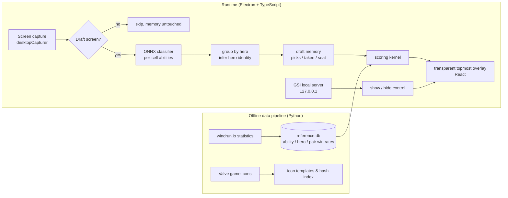

# AD 选取助手 · Dota 2 Ability Draft Assistant

**English** | [中文](README.zh-CN.md)

A desktop overlay for Dota 2's **Ability Draft** (AD) mode. It captures the draft screen, recognizes all 48 abilities and 12 heroes in the pool, remembers what every player has taken, and recommends your best next pick based on the current round and what you already own, drawing the recommendations as highlights directly on the in-game board.

It is read-only by design: no memory reading, no injection, no simulated input. The only window it ever modifies is its own overlay.

---

## The problem

In Ability Draft, 10 players take turns picking from a random pool (5 rounds, 50 picks, snake order), with only a few seconds per pick. A good pick depends on:

- how strong the ability is on its own;
- how well it combines with the abilities and hero you already have (strong combos often matter far more than single abilities);
- the current round: grab strong standalone abilities early, complete combos later;
- what you still need (hero, regular abilities and ultimate each have fixed slots).

That is hard to weigh in a few seconds. This project turns it into a tunable scoring formula and shows the top recommendations after every scan.

## Features

- **Full-board recognition**: from one screenshot, identifies the 48 abilities in the pool (12 ultimates + 36 regular), the 12 available heroes, and which cells have already been taken.
- **Player state**: detects which seat is yours, whose turn it is, your hero and abilities so far, and the current round and pick number.
- **Pick scoring**: single-ability win rate + synergy with what you already own + Aghanim's Scepter / Shard bonuses + slot need, with weights that shift smoothly from pick to pick. Abilities and heroes are scored separately, then merged into one ranking.
- **In-game highlights**: recommendations are outlined on the matching pool cells, with a side panel showing scores and reasons.
- **Automatic show/hide**: uses Valve's official Game State Integration (GSI) to appear only during hero selection and hide during strategy time, in game, and in the main menu. Without GSI it falls back to judging from the screen.
- **Hot-reloaded weights**: scoring weights live in `scoring_config.json`; save the file and the next scan uses them.

## Architecture



### Recognition: from pixel matching to classifier + reasoning

The first version compared each cell's icon by perceptual hash (pHash). Across many real-game tests it never managed to recognize the whole pool reliably. The rework:

1. **An ONNX classifier recognizes abilities.** Each cell is cropped to 96×96 RGB and fed to a MobileNetV2 classifier (528 classes); below 0.9 confidence counts as unrecognized. Empty cells are detected by pixel variance and never reach the model. Image resizing is pure TypeScript bilinear interpolation, with no native image library.
2. **Heroes are inferred from groups.** A hero's abilities always sit together in the pool. Three regular abilities from the same hero, or two plus a matching ultimate, identify the hero; only when two remain is the hero portrait checked. Portraits are never classified directly.
3. **Draft memory.** Recognized names are never overwritten by later scans. A cell counts as taken only when a player card confirms it or it is empty in two consecutive scans. A large mismatch with memory is detected as a new draft.
4. **Draft-screen gate.** Frames of the main menu, loading screens or pop-ups are skipped so they can't pollute memory.

Checked cell by cell on 14 real-game screenshots: **593 / 593** correct, plus several full drafts played live. A regression test replays locally saved real-game frames.

### Scoring

```
score = w_base(pick) · S_base
      + w_synergy(pick) · S_synergy(best N pairs with what you own)
      + w_aghs(pick) · S_aghs + w_shard(pick) · S_shard
      + categoryNeed(pick, missing slot types)
```

- Weights are set per round (5 rounds) and interpolated across the 50 picks: the single-ability weight falls over time while the synergy weight rises.
- When pair data is missing, synergy is estimated from the ability's own strength and from similar abilities (clustered by ability tags).
- Scepter / Shard count only the gain above a baseline, with a stacking bonus and a cap.

### Staying on the right side of the line (compliance)

For a tool like this, the most important thing is never to cross from assistant into cheat. The code enforces it:

- It only captures the screen. **No memory reading, no injection, no render hooks, no simulated keyboard or mouse input.**
- Win32 write calls (topmost, click-through) **only target the app's own overlay**; the game window handle has a read-only type.
- The GSI local server **listens on 127.0.0.1 only** and checks a token. Its config file is written into the Dota folder only after the user confirms a dialog, it is the only file written there, and it can be removed at any time.
- `npm run compliance` scans all source code and fails on any out-of-bounds API.

## Tech stack

| Layer | Technology |
|---|---|
| Desktop shell | Electron 31 · electron-vite |
| UI | React 18 (transparent topmost overlay) |
| Recognition | onnxruntime-node (MobileNetV2 classifier) · pure-TS image processing · pHash as a second opinion |
| System calls | koffi (Win32 FFI: find window, read client area, style its own window) |
| Data | SQLite (node-sqlite3-wasm, pure WASM, no native build) |
| Offline pipeline | Python (fetches statistics, builds the reference DB and icon index) |
| Tests | Vitest (~290 tests) · pytest |
| Language | TypeScript (strict) |

## Repository layout

```
shared/     shared types (draft state, recommendations, IPC messages)
core/       pure logic, no Electron: recognition, memory, scoring, GSI parsing
main/       main-process capabilities: capture, Win32 FFI, GSI server, Dota path lookup
renderer/   React overlay UI
app/        Electron entry point that wires the layers together
pipeline/   Python offline data pipeline
models/     classifier model, icon templates, ability tags
scripts/    compliance scan
docs/       design and implementation plans for each phase
```

`core` has no Electron dependency, so recognition and scoring are tested in plain Node.

## Running

Requires Windows and Node.js (developed on 22), with Dota 2 in borderless window mode.

```bash
npm install          # install all workspace dependencies
npm run test:ts      # run all TypeScript tests
npm run compliance   # compliance red-line scan
npm run dev          # start the overlay
```

Press `Ctrl+Shift+S` on the draft screen to scan. GSI can be enabled from the tray menu (restart Dota once afterwards).

## How it was built

The project moved in phases: write a plan, implement test-first, then verify on the real game. All plans are in [`docs/superpowers/plans/`](docs/superpowers/plans/) (in Chinese). Some turning points:

- **Re-mapping the layout.** The first design assumed ten rows of players; the real screen has two columns of five and a pool split into ultimate and regular zones, so the coordinate system was redone.
- **Rebuilding recognition.** pHash kept failing in real games; switching to a classifier plus group reasoning went from "can't recognize the whole pool" to every cell correct.
- **Driven by real-game bugs.** For example, 125% Windows scaling sizing the overlay wrong, main-menu frames polluting memory, and high-contrast hero portraits being misread as taken. Each was traced to its cause and covered by a test before being fixed.

## Status and roadmap

- [x] Full-board recognition, player state, pick scoring, in-game highlights
- [x] GSI automatic show/hide, memory reset on a new draft
- [ ] Automatic scanning during the draft (no hotkey)
- [ ] Tune weights from full draft logs
- [ ] Installer and first-run setup
- [ ] Resolutions other than 1920×1080

## Credits

- The ability classifier model comes from [ability-draft-plus](https://github.com/Tiarin-Hino/ability-draft-plus) (ISC License, see `models/classifier/LICENSE-ability-draft-plus.txt`).
- Ability and synergy win-rate data comes from [windrun.io](https://windrun.io).
- Dota 2 and its game assets are property of Valve Corporation. This project is not affiliated with Valve.
