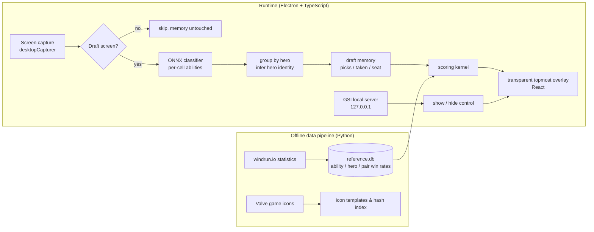

# AD 选取助手 · Dota 2 Ability Draft Assistant

**English** | [中文](README.zh-CN.md)

A desktop overlay for Dota 2's **Ability Draft** (AD) mode. It captures the draft screen, recognizes all 48 abilities and 12 heroes in the pool, remembers what every player has taken, and recommends your best next pick based on the current round and what you already own, drawing the recommendations as highlights directly on the in-game board.

It is read-only by design: no memory reading, no injection, no simulated input. The only window it ever modifies is its own overlay.

## Results at a glance

Measured on a real machine in live Dota 2 games (from the app's own scan log), plus the automated test suites.

| Metric | Result |
|---|---|
| **Recognition accuracy** | **593 / 593** cells correct in a cell-by-cell audit of 14 real-game screenshots, **0 mislabels** |
| **Live accuracy (1080p)** | **185 / 185** live draft scans with every pool cell recognized (5,379 / 5,379 cells) |
| **Speed** | full-board recognition in **193 ms median / 262 ms p90** (60 cells + player cards + scoring) |
| **Latency vs. v1** | **~7× faster**: ~1.4 s per manual hotkey scan → ~0.2 s, fully automatic (200+ hands-free scans in live games) |
| **Screen sizes** | 6 aspect-ratio classes; **0 px placement error** at all 6 window sizes measured; 100% recognition at 1600×900 and 21:9 |
| **Safety & quality** | read-only capture, 0 compliance-scan violations · **~430 automated tests**, incl. replay of real-game frames |

The classifier abstains below 0.9 confidence instead of guessing, so an uncertain cell shows as unknown rather than as a wrong ability.

---

## The problem

In Ability Draft, 10 players take turns picking from a random pool (5 rounds, 50 picks, snake order), with only a few seconds per pick. A good pick depends on:

- how strong the ability is on its own;
- how well it combines with the abilities and hero you already have (strong combos often matter far more than single abilities);
- the current round: grab strong standalone abilities early, complete combos later;
- what you still need (hero, regular abilities and ultimate each have fixed slots).

That is hard to weigh in a few seconds. This project turns it into a tunable scoring formula and shows the top recommendations after every scan.

## Features

- **Full-board recognition**: from one screenshot, identifies the 48 abilities in the pool (12 ultimates + 36 regular), the 12 available heroes, and which cells have already been taken.
- **Player state**: detects which seat is yours, whose turn it is, your hero and abilities so far, and the current round and pick number.
- **Pick scoring**: single-ability win rate + synergy with what you already own + Aghanim's Scepter / Shard bonuses + slot need, with weights that shift smoothly from pick to pick. Abilities and heroes are scored separately, then merged into one ranking.
- **In-game highlights**: recommendations are outlined on the matching pool cells, with a side panel showing scores and reasons.
- **Automatic scanning**: watches the screen continuously, waits for the board to settle, and rescans on every change. No hotkey needed; recommendations freeze while it is your turn so they don't jump under the cursor.
- **Automatic show/hide**: uses Valve's official Game State Integration (GSI) to appear only during hero selection and hide during strategy time, in game, and in the main menu. Without GSI it falls back to judging from the screen.
- **Hot-reloaded weights**: scoring weights live in `scoring_config.json`; save the file and the next scan uses them.

## Architecture



### Recognition: from pixel matching to classifier + reasoning

The first version compared each cell's icon by perceptual hash (pHash). Across many real-game tests it never managed to recognize the whole pool reliably. The rework:

1. **An ONNX classifier recognizes abilities.** Each cell is cropped to 96×96 RGB and fed to a MobileNetV2 classifier (528 classes); below 0.9 confidence counts as unrecognized. Empty cells are detected by pixel variance and never reach the model. Image resizing is pure TypeScript bilinear interpolation, with no native image library.
2. **Heroes are inferred from groups.** A hero's abilities always sit together in the pool. Three regular abilities from the same hero, or two plus a matching ultimate, identify the hero; only when two remain is the hero portrait checked. Portraits are never classified directly.
3. **Draft memory.** Recognized names are never overwritten by later scans. A cell counts as taken only when a player card confirms it or it is empty in two consecutive scans. A large mismatch with memory is detected as a new draft.
4. **Draft-screen gate.** Frames of the main menu, loading screens or pop-ups are skipped so they can't pollute memory.

Checked cell by cell on 14 real-game screenshots: **593 / 593** correct. In live 1080p games, 185 of 185 draft scans recognized every pool cell, at a median of 193 ms per full scan. A regression test replays locally saved real-game frames.

### Scoring

```
score = w_base(pick) · S_base
      + w_synergy(pick) · S_synergy(best N pairs with what you own)
      + w_aghs(pick) · S_aghs + w_shard(pick) · S_shard
      + categoryNeed(pick, missing slot types)
```

- Weights are set per round (5 rounds) and interpolated across the 50 picks: the single-ability weight falls over time while the synergy weight rises.
- When pair data is missing, synergy is estimated from the ability's own strength and from similar abilities (clustered by ability tags).
- Scepter / Shard count only the gain above a baseline, with a stacking bonus and a cap.

### Staying on the right side of the line (compliance)

For a tool like this, the most important thing is never to cross from assistant into cheat. The code enforces it:

- It only captures the screen. **No memory reading, no injection, no render hooks, no simulated keyboard or mouse input.**
- Win32 write calls (topmost, click-through) **only target the app's own overlay**; the game window handle has a read-only type.
- The GSI local server **listens on 127.0.0.1 only** and checks a token. Its config file is written into the Dota folder only after the user confirms a dialog, it is the only file written there, and it can be removed at any time.
- `npm run compliance` scans all source code and fails on any out-of-bounds API.

## Tech stack

| Layer | Technology |
|---|---|
| Desktop shell | Electron 31 · electron-vite |
| UI | React 18 (transparent topmost overlay) |
| Recognition | onnxruntime-node (MobileNetV2 classifier) · pure-TS image processing · pHash as a second opinion |
| System calls | koffi (Win32 FFI: find window, read client area, style its own window) |
| Data | SQLite (node-sqlite3-wasm, pure WASM, no native build) |
| Offline pipeline | Python (fetches statistics, builds the reference DB and icon index) |
| Tests | Vitest (394 tests) · pytest (38 tests) |
| Language | TypeScript (strict) |

## Repository layout

```
shared/     shared types (draft state, recommendations, IPC messages)
core/       pure logic, no Electron: recognition, memory, scoring, GSI parsing
main/       main-process capabilities: capture, Win32 FFI, GSI server, Dota path lookup
renderer/   React overlay UI
app/        Electron entry point that wires the layers together
pipeline/   Python offline data pipeline
models/     classifier model, icon templates, ability tags
scripts/    compliance scan
docs/       design and implementation plans for each phase
```

`core` has no Electron dependency, so recognition and scoring are tested in plain Node.

## Download and install

No development setup is needed: download the latest `AD-Assistant-Setup-x.y.z.exe` from the [Releases](https://github.com/carlhan0817/AD/releases) page and run it (64-bit Windows 10/11 only).

- **Windows security prompt**: the installer is not code-signed, so the first run shows "Windows protected your PC". Click "More info" → "Run anyway".
- **Using it**: the app lives in the system tray and has no main window. Run Dota 2 in **borderless window** mode; when you reach the Ability Draft screen, recommendations appear in the top-right corner. `Ctrl+Shift+S` forces a scan at any time. Right-click the tray icon to toggle automatic scanning, enable in-game tracking (启用游戏内追踪), or quit. The tray menu is in Chinese.
- **What it reads**: read-only. It captures the Dota 2 screen and reads hero portraits from your local Dota install (to recognize the hero you picked); it does not modify any game file. The one exception: if you enable in-game tracking from the tray and confirm, it writes one file into Dota's config folder.
- **Troubleshooting**: the log is at `%APPDATA%\AD Assistant\ad-assistant.log`; please attach it to issues.
- **Data version**: win-rate data is a snapshot taken when the installer was built. Download a new installer after a game patch.

## Running from source

Requires Windows and Node.js (developed on 22), with Dota 2 in borderless window mode.

```bash
npm install          # install all workspace dependencies
npm run test:ts      # run all TypeScript tests
npm run compliance   # compliance red-line scan
npm run dev          # start the overlay
npm run dist         # build the Windows installer into app/release/
```

Building the installer needs `pipeline/out/reference.db` (generate it with `python -m ad_pipeline build` in `pipeline/`; it is not committed). `npm run dist` stops with an error if it is missing.

Scanning is automatic during the draft (toggle "自动扫描" in the tray menu); `Ctrl+Shift+S` forces a scan at any time. GSI can be enabled from the tray menu (restart Dota once afterwards).

## Supported screens

The overlay locates the draft screen by the aspect ratio of the Dota 2 window, within 0.02 of one of these classes:

| Ratio | Example resolutions | Status |
|---|---|---|
| 16:9 | 1280×720, 1366×768, 1600×900, **1920×1080**, 2560×1440, 3840×2160 | 1920×1080 tested on a real machine; 1600×900, 1366×768, 1360×768 and 1280×720 tested in windowed mode (at 1366×768 and smaller, up to 5–6 of the 48 pool cells can stay unrecognized per scan: the cells are in the right place, the icon classifier is just less sure at that size); 2560×1440 and up supported by formula, not yet tested |
| 21:9 | 1834×786, 2560×1080, 3440×1440 | 1834×786 tested in windowed mode for pool and hero cells (player cards not yet verified); other sizes supported by formula |
| 16:10 | 1440×900, 1920×1200, 2560×1600 | supported by upstream data, not yet tested |
| 3:2 | 1440×960 | supported by upstream data, not yet tested |
| 4:3 | 1024×768, 1280×960, 1400×1050 | 1400×1050 tested in windowed mode: heroes, player cards and your seat are read; 3 of the 48 pool cells stayed unrecognized per scan (classifier confidence 0.52–0.83, not a position error). Layout still from upstream data |
| 5:4 | 1280×1024 | supported by upstream data, not yet tested |

Ratio bands: each class accepts its target ratio ±0.02, except 21:9, which accepts 2.31–2.42 (ultrawide screens come in several shapes). A window whose ratio is outside every band (for example 1600×1024, which falls between classes) is not scanned, and the app shows an "unsupported screen ratio" notice (当前屏幕比例暂不支持,请看项目主页).

Also not supported, with no notice: exclusive fullscreen and Dota 2 on a non-primary display. Run Dota 2 as a borderless window on the primary display; otherwise results will be wrong.

## How it was built

The project moved in phases: write a plan, implement test-first, then verify on the real game. All plans are in [`docs/superpowers/plans/`](docs/superpowers/plans/) (in Chinese). Some turning points:

- **Re-mapping the layout.** The first design assumed ten rows of players; the real screen has two columns of five and a pool split into ultimate and regular zones, so the coordinate system was redone.
- **Rebuilding recognition.** pHash kept failing in real games; switching to a classifier plus group reasoning went from "can't recognize the whole pool" to every cell correct.
- **Driven by real-game bugs.** For example, 125% Windows scaling sizing the overlay wrong, main-menu frames polluting memory, and high-contrast hero portraits being misread as taken. Each was traced to its cause and covered by a test before being fixed.

## Status and roadmap

- [x] Full-board recognition, player state, pick scoring, in-game highlights
- [x] GSI automatic show/hide, memory reset on a new draft
- [x] Automatic scanning during the draft (no hotkey)
- [ ] Tune weights from full draft logs
- [x] Windows installer (see Download and install)
- [ ] First-run setup
- [x] Resolutions other than 1920×1080 (see Supported screens)

## Credits

- The ability classifier model comes from [ability-draft-plus](https://github.com/Tiarin-Hino/ability-draft-plus) (ISC License, see `models/classifier/LICENSE-ability-draft-plus.txt`).
- Ability and synergy win-rate data comes from [windrun.io](https://windrun.io).
- Dota 2 and its game assets are property of Valve Corporation. This project is not affiliated with Valve. The installer does not contain any Valve artwork.

## License

The code in this repository is released under the [MIT License](LICENSE).
