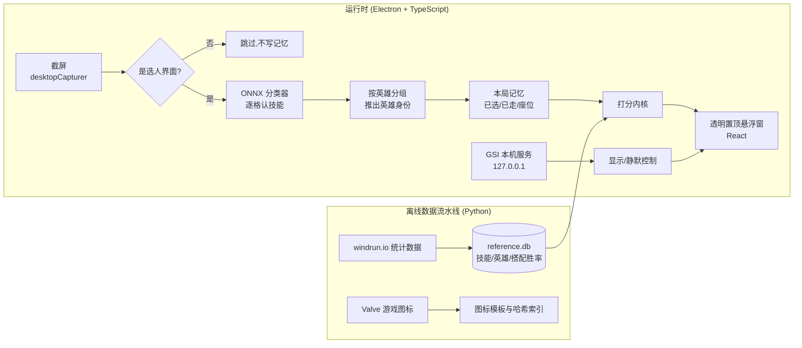

# AD 选取助手 · Dota 2 Ability Draft Assistant

[English](README.md) | **中文**

Dota 2「技能征召」(Ability Draft,AD)模式的桌面选取助手。程序截取选人画面,认出技能池里的 48 个技能和 12 个英雄,记住每位玩家选走了什么,再按当前轮次和你已选的组合给出推荐,直接在游戏画面的技能格上框出来。

全程只读屏幕:不读游戏内存、不注入、不模拟按键,只对自己的悬浮窗做窗口操作。

---

## 它解决什么问题

AD 模式里,10 名玩家轮流从一个随机池子里挑技能(5 轮、50 手,蛇形顺序),每手只有几秒钟。好的选择取决于:

- 单个技能本身强不强;
- 和你已经选到的技能、英雄搭不搭(很多强势组合远比单技能重要);
- 现在是第几轮——前期该抢强势单技能,后期该补组合;
- 你还缺哪类(英雄 / 普通技能 / 大招各有名额)。

人在几秒内很难同时算清这些。本项目把它们量化成一个可调的打分公式,每次扫描后给出前几名推荐。

## 功能

- **整盘识别**:一次截图认出池中 48 个技能(12 大招 + 36 普通)和 12 个可选英雄,以及被选走的格子。
- **玩家状态**:识别「我」坐哪个位置、现在轮到谁、我已选了哪个英雄和哪些技能、当前是第几轮第几手。
- **推荐打分**:单技能胜率 + 与已选技能/英雄的搭配胜率 + 神杖/魔晶加成 + 类别缺口,权重按手数平滑过渡;技能与英雄分开推荐再合并排序。
- **游戏内标注**:推荐直接在技能池对应格子上画框,另有右下角面板显示分数和原因。
- **自动出现/隐藏**:接入 Valve 官方 Game State Integration(GSI),只在选人阶段显示,策略时间、游戏中、主菜单自动隐藏;没开 GSI 时退回按画面判断。
- **权重热更新**:打分权重放在 `scoring_config.json`,改完保存,下一次扫描立即生效。

## 架构



### 识别:从「像素比对」到「分类器 + 规则推理」

早期版本用感知哈希(pHash)逐格比对图标,多轮真机测试都无法稳定认全池子。重做后的方案:

1. **ONNX 分类器**认技能:每格裁成 96×96 RGB,送入 MobileNetV2 分类器(528 类),置信度低于 0.9 视为没认出;空格用像素方差直接判定,不进模型。图像缩放用纯 TypeScript 双线性插值实现,不依赖原生图像库。
2. **按英雄分组推英雄**:池子里同一英雄的技能固定排在一起。3 个普通技能属于同一英雄、或 2 个普通技能加 1 个大招吻合,即可确定该英雄;只剩 2 个时再用英雄头像核对。英雄头像本身不直接识别。
3. **本局记忆**:认出的名字不会被后续扫描覆盖;格子被选走须经玩家卡确认或连续 2 次为空才记为已走;池子大面积不一致时自动判定为新的一局。
4. **选人界面门控**:截到主菜单、加载画面或弹窗时直接跳过,避免污染记忆。

在 14 张真机截图上逐格核对 **593 / 593** 全部正确,另有多局完整对局的实测;识别回归测试会对本地保存的真机帧逐帧比对。

### 打分

```
score = w_base(pick) · S_base
      + w_synergy(pick) · S_synergy(与已选最配的 N 件)
      + w_aghs(pick) · S_aghs + w_shard(pick) · S_shard
      + categoryNeed(pick, 缺的类别)
```

- 权重表按 5 轮给出,在 50 手之间线性插值:单技能分逐轮下降,搭配分逐轮上升。
- 搭配数据缺失时,按单技能强度与同类技能(按技能标签聚类)回退估计。
- 神杖/魔晶只计高于基线的超额收益,并有叠加奖励与上限。

### 与游戏的边界(合规设计)

这类工具最重要的是不越过「辅助」和「外挂」的界线,项目在代码层面强制执行:

- 只截取屏幕画面,**不读游戏内存、不注入、不 hook 渲染、不模拟键鼠**;
- Win32 写操作(置顶、点击穿透)**只作用于自己的悬浮窗**,游戏窗口句柄在类型上被标记为只读;
- GSI 本机服务**只监听 127.0.0.1**,校验口令;配置文件只在用户确认弹窗后写入 Dota 目录这一个文件,可随时删除;
- `npm run compliance` 扫描全部源码,出现越界 API 即失败。

## 技术栈

| 层 | 技术 |
|---|---|
| 桌面外壳 | Electron 31 · electron-vite |
| 界面 | React 18(透明置顶悬浮窗) |
| 识别 | onnxruntime-node(MobileNetV2 分类器)· 纯 TS 图像处理 · pHash 作为第二意见 |
| 系统调用 | koffi(Win32 FFI:找窗口、读客户区、改自身窗口样式) |
| 数据 | SQLite(node-sqlite3-wasm,纯 WASM,免原生编译) |
| 离线流水线 | Python(拉取统计数据、生成参考库与图标索引) |
| 测试 | Vitest(约 290 个用例)· pytest |
| 语言 | TypeScript(严格模式) |

## 仓库结构

```
shared/     共享类型(选人状态、推荐、IPC 消息)
core/       纯逻辑,不依赖 Electron:识别、记忆、打分、GSI 解析
main/       主进程侧能力:截屏、Win32 FFI、GSI 本机服务、Dota 路径查找
renderer/   React 悬浮窗界面
app/        Electron 入口,把以上各层接起来
pipeline/   Python 离线数据流水线
models/     分类器模型、图标模板、技能标签
scripts/    合规扫描
docs/       各阶段设计与实施方案
```

`core` 不依赖 Electron,所以识别和打分都能在普通 Node 环境下直接测试。

## 运行

需要 Windows、Node.js(开发时用 22);Dota 2 以无边框窗口模式运行。

```bash
npm install          # 安装所有 workspace 依赖
npm run test:ts      # 运行全部 TypeScript 测试
npm run compliance   # 合规红线扫描
npm run dev          # 启动悬浮窗
```

在选人界面按 `Ctrl+Shift+S` 扫描一次。托盘菜单里可以启用 GSI(启用后需重启 Dota 一次)。

## 支持的屏幕

悬浮窗按 Dota 2 窗口的宽高比定位选人界面,比例与下列某一类相差不超过 0.02 即支持:

| 比例 | 常见分辨率 | 状态 |
|---|---|---|
| 16:9 | 1366×768、**1920×1080**、2560×1440、3840×2160 | 1920×1080 已实测;其余按公式支持,未实测 |
| 21:9 | 2560×1080、3440×1440 | 按公式支持,未实测 |
| 16:10 | 1440×900、1920×1200、2560×1600 | 按上游数据支持,未实测 |
| 3:2 | 1440×960 | 按上游数据支持,未实测 |
| 4:3 | 1024×768、1280×960 | 按上游数据支持,未实测 |
| 5:4 | 1280×1024 | 按上游数据支持,未实测 |

不支持:比例与上面每一类都相差超过 0.02(落在两类之间的比例,如 1600×1024,不支持)、独占全屏、Dota 2 不在主显示器上。遇到这些情况,程序会提示「当前屏幕比例暂不支持,请看项目主页」(unsupported screen ratio),并且不会扫描。

## 开发过程

项目按阶段推进,每一阶段先写方案、再测试驱动实现、最后真机验证,方案文档都在 [`docs/superpowers/plans/`](docs/superpowers/plans/)。几个关键的转折:

- **布局重标**:最初假设玩家是十行排列,真机发现是左右两列各 5 人、技能池分大招区和普通区,整体重做坐标体系。
- **识别重做**:pHash 方案在真机上反复失败,改用分类器 + 按组推理,准确率从「无法认全」到逐格全对。
- **真机问题驱动**:例如 125% 系统缩放导致悬浮窗尺寸错误、截到主菜单污染记忆、高对比英雄头像被误判为已选——每个都先定位原因、补测试,再修复。

## 现状与计划

- [x] 整盘识别、玩家状态、推荐打分、游戏内标注
- [x] GSI 自动显示/隐藏、换局自动清空
- [ ] 选人阶段自动扫描(去掉热键)
- [ ] 用完整对局记录调优权重
- [ ] 安装包与首次启动引导
- [ ] 支持 1920×1080 以外的分辨率

## 致谢

- 技能分类器模型来自 [ability-draft-plus](https://github.com/Tiarin-Hino/ability-draft-plus)(ISC License,见 `models/classifier/LICENSE-ability-draft-plus.txt`)。
- 技能与搭配胜率数据来自 [windrun.io](https://windrun.io)。
- Dota 2 及其游戏素材归 Valve Corporation 所有,本项目与 Valve 无关。
